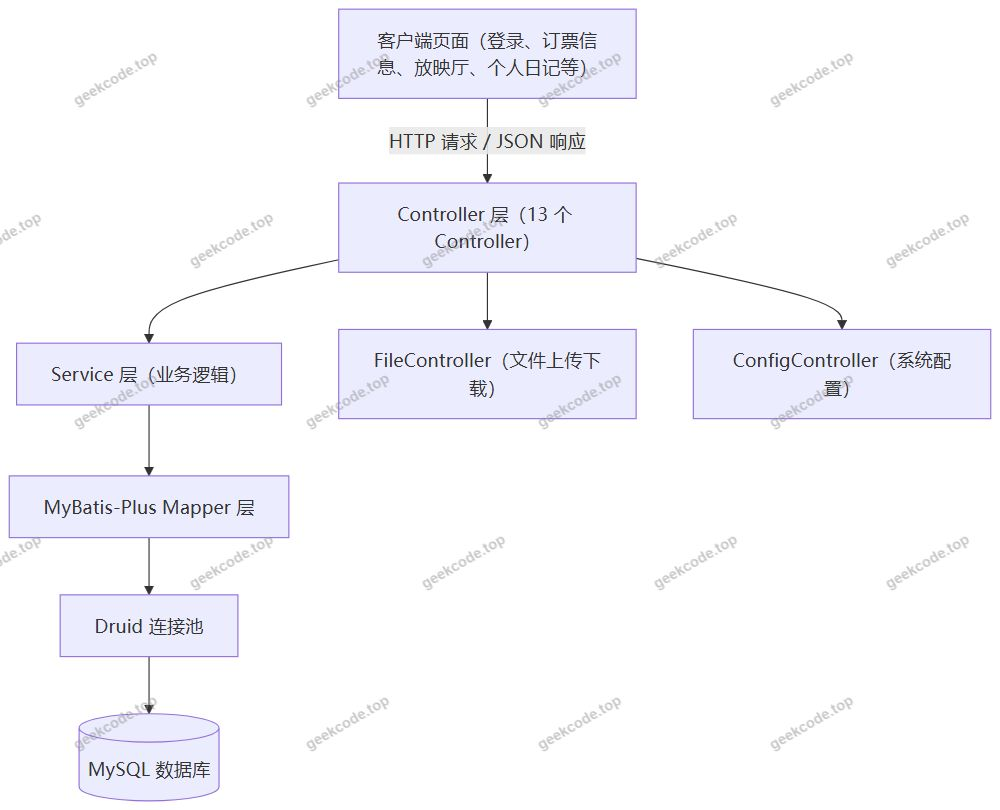
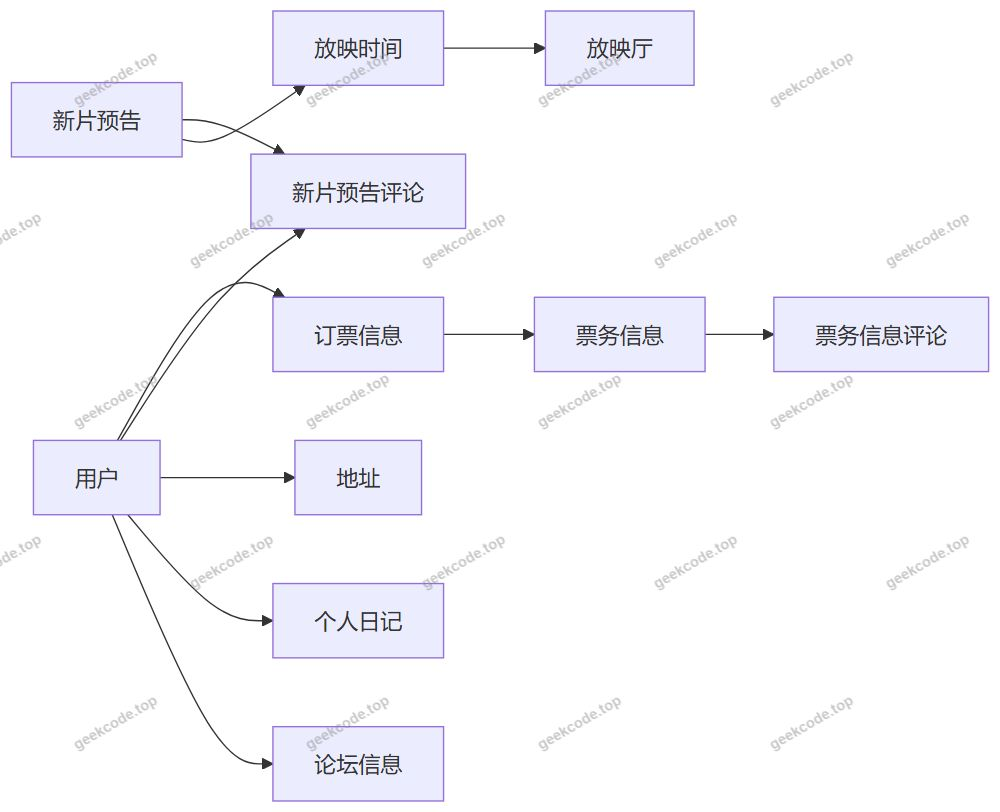
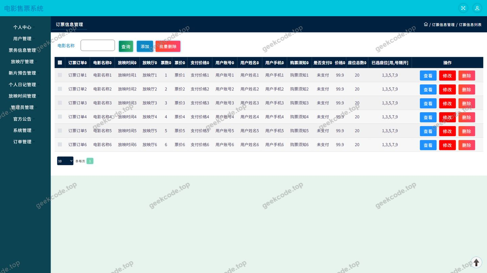
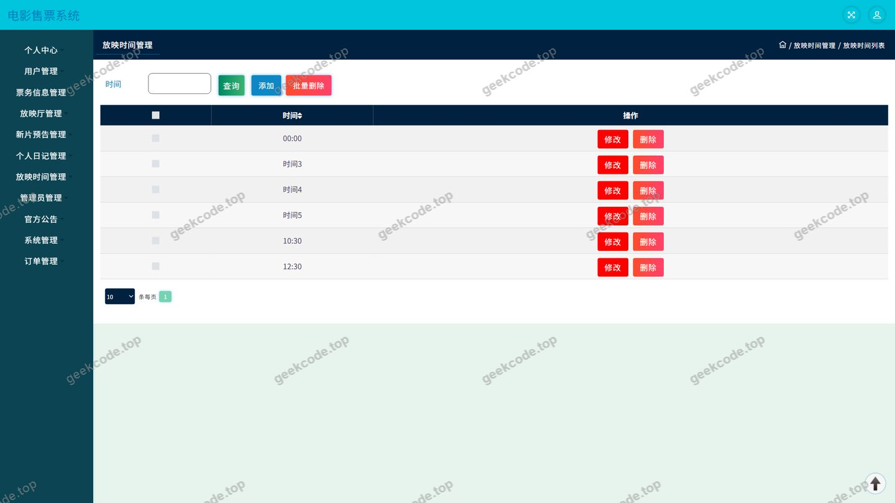
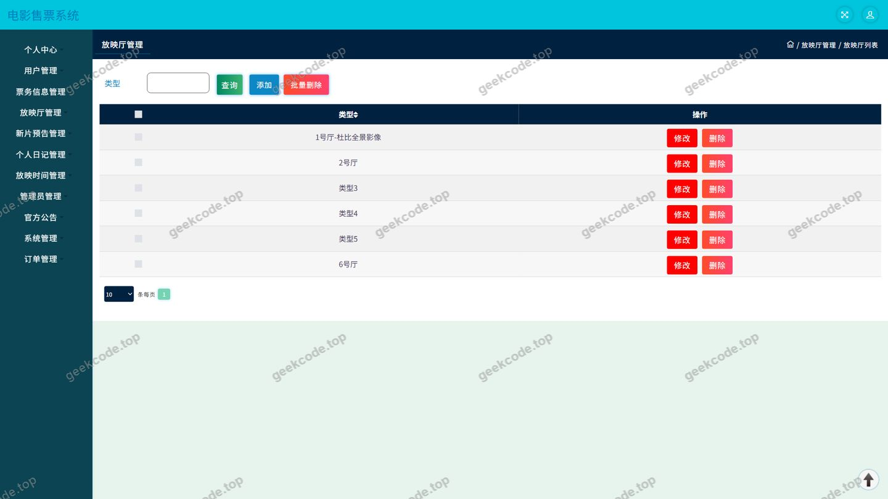
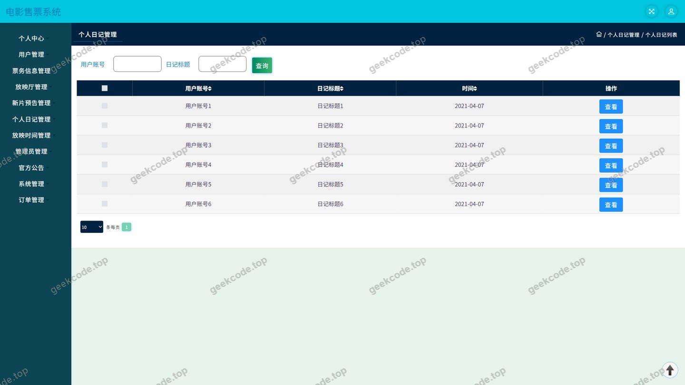
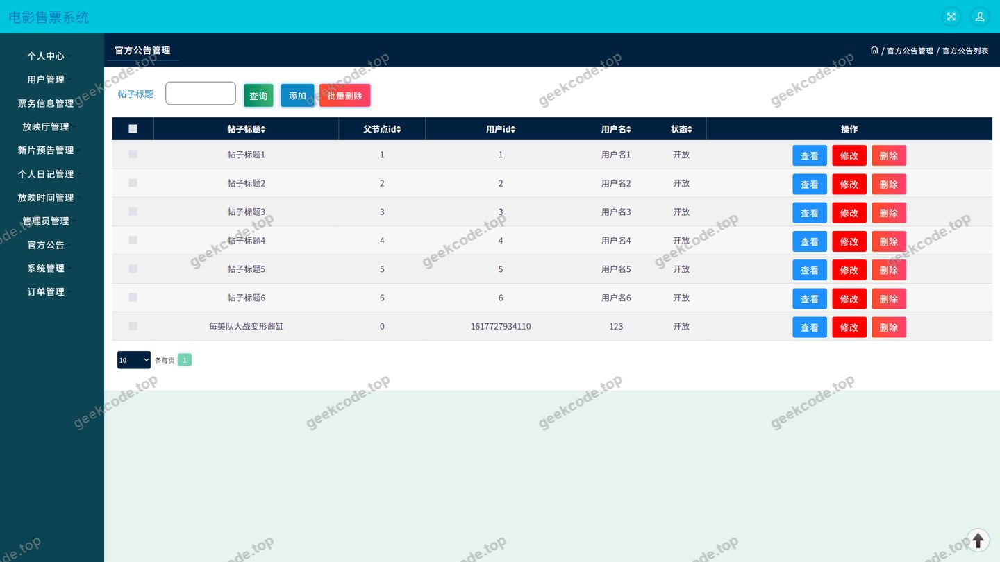
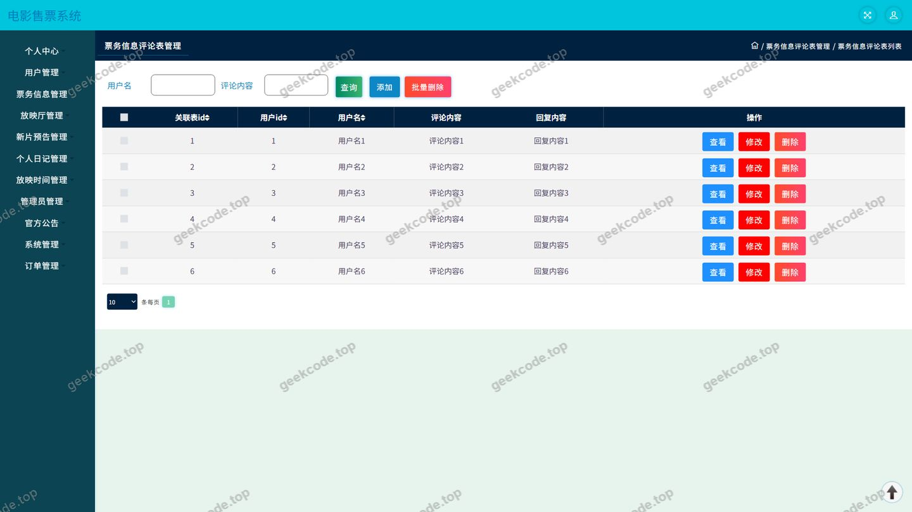
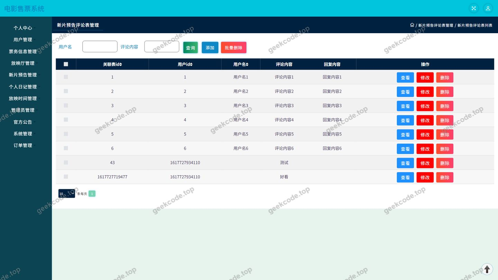
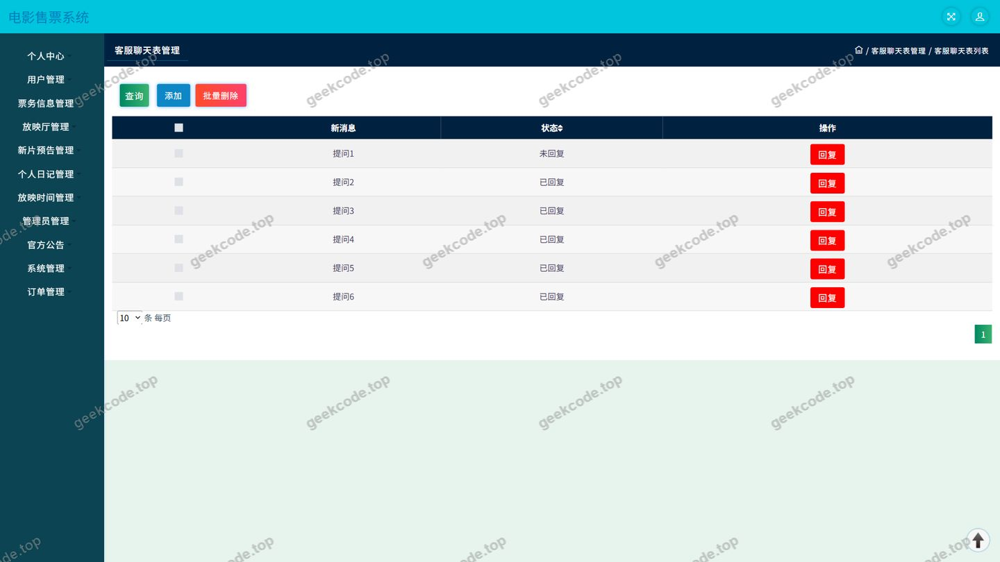

# ssm电影售票系统-java毕业设计

> 🎓 **计算机毕业设计 · ssm电影售票系统-java毕业设计**
>
> 本仓库只放**项目介绍 + 运行截图**（截图是站点带水印的原图，存在仓库 `images/` 里）。
>
> 👉 **完整可运行源码 / 数据库脚本 / 部署文档：[点我获取](https://geekcode.top/archives/ssm%E7%94%B5%E5%BD%B1%E5%94%AE%E7%A5%A8%E7%B3%BB%E7%BB%9F-java%E6%AF%95%E4%B8%9A%E8%AE%BE%E8%AE%A1?utm_source=github)**
>
> 💬 咨询微信：**ir9372**　|　🌐 更多项目：[极客代码 geekcode.top](https://geekcode.top/?utm_source=github)
>
> 📌 项目详情页：<https://geekcode.top/archives/ssm%E7%94%B5%E5%BD%B1%E5%94%AE%E7%A5%A8%E7%B3%BB%E7%BB%9F-java%E6%AF%95%E4%B8%9A%E8%AE%BE%E8%AE%A1?utm_source=github>

<table><td width="230" align="center"> <b>扫码加微信 ir9372</b></td><td valign="middle">📦 源码 = 项目介绍 + 全部运行截图 + 数据库 + 部署文档 👉 点上方任意截图，直接跳到 <b>极客代码 geekcode.top</b> 详情页</td></table>

---

<h1>ssm电影售票系统-java毕业设计</h1>
<h2>项目概述</h2>

本项目为“电影售票系统”，定位为一套面向影院观影业务的接口服务型（pure-api）毕业设计系统。项目采用经典分层架构，以 Spring 容器与 Spring MVC 为核心，整合 MyBatis-Plus 持久层框架与 Druid 数据库连接池，向外部客户端提供统一的 HTTP 数据接口，不包含服务端渲染页面、不包含独立的前台与后台路由配置。

系统围绕“观影购票”主线展开，覆盖新片预告、放映厅、放映时间、票务信息、订票信息等核心业务环节，并在此基础上扩展出票务信息评论、新片预告评论、论坛信息、新闻资讯、官方公告、个人日记、在线交流、地址管理等社区化与个人化功能，形成“内容浏览—互动评论—下单订票—个人管理”的完整使用链路。

适用场景为电影院线日常售票与信息发布，适用人群包括两类：一是需要浏览影片资讯、查询放映安排并完成订票的普通观影用户；二是需要对影片、场次、票务、公告及用户内容进行维护的系统管理人员。项目适合作为计算机专业毕业设计中的后端接口服务类课题，也适合作为影院信息化系统的原型参考。

<h2>技术架构</h2>
<h3>整体架构</h3>

系统采用前后端分离的组织方式：后端对外输出接口，客户端通过 HTTP 请求获取 JSON 数据。后端内部遵循 Controller—Service—Mapper 的三层结构，共提供 13 个 Controller 作为业务入口，持久层由 MyBatis-Plus 承担，Druid 负责数据库连接的创建、复用与监控。

<h3>技术依赖构成</h3>

后端依赖以 Spring 生态为主，具体包括：

<ul>
<li>核心容器：spring-core、spring-beans、spring-context、spring-context-support</li>
<li>Web 层：spring-web、spring-webmvc</li>
<li>事务与切面：spring-tx、spring-aop</li>
<li>数据库访问：spring-jdbc、MyBatis-Plus、Druid</li>
<li>测试：junit</li>
</ul>

依赖以 Maven 坐标形式组织，说明项目采用 Maven 进行依赖管理与构建。

<h3>数据访问设计要点</h3>
<ul>
<li>采用 MyBatis-Plus 作为 ORM 框架，通过通用 Mapper 与条件构造器减少单表增删改查的样板代码，实体与业务表一一对应。</li>
<li>数据库选用 MySQL，连接资源统一交由 Druid 连接池管理，便于进行连接监控与 SQL 性能观察。</li>
<li>事务控制由 spring-tx 提供，涉及订票、评论发布等多表写入的业务在 Service 层进行事务边界划分。</li>
</ul>
<h3>业务数据结构要点</h3>

依据 Controller 命名与功能页面，系统涉及的主要业务数据结构包括：

具体字段级设计（如主键策略、字段类型、索引设置）未在现有信息中提供，根据现有信息无法确定。

<h2>功能模块</h2>
<h3>前台用户端模块</h3>

前台导航栏包含“票务信息、新片预告、论坛信息、新闻资讯”四个主入口，个人中心包含“个人中心、我的发布、我的订单、我的地址、我的收藏”五个子入口，据此划分用户端功能如下：

<table>
<thead>
<tr>
<th>模块</th>
<th>说明</th>
<th>对应接口</th>
</tr>
</thead>
<tbody><tr>
<td>登录</td>
<td>用户身份认证入口，为订票、评论、发布等操作提供身份基础</td>
<td>通用接口模块</td>
</tr>
<tr>
<td>票务信息</td>
<td>展示在售票务内容，支持查看详情</td>
<td>DingpiaoxinxiController 关联业务</td>
</tr>
<tr>
<td>票务信息评论</td>
<td>针对票务信息发表评论与查看评论列表</td>
<td>DiscusspiaowuxinxiController</td>
</tr>
<tr>
<td>新片预告</td>
<td>展示待映或即将上映影片的预告内容</td>
<td>预告内容相关接口</td>
</tr>
<tr>
<td>新片预告评论</td>
<td>针对新片预告内容发表评论与查看评论列表</td>
<td>DiscussxinpianyugaoController</td>
</tr>
<tr>
<td>放映时间</td>
<td>查询影片对应的放映场次与时间安排</td>
<td>FangyingshijianController</td>
</tr>
<tr>
<td>放映厅</td>
<td>展示放映厅信息，配合场次查询使用</td>
<td>FangyingtingController</td>
</tr>
<tr>
<td>新闻资讯</td>
<td>展示系统发布的新闻类资讯内容</td>
<td>资讯内容相关接口</td>
</tr>
<tr>
<td>官方公告</td>
<td>展示系统公告信息</td>
<td>公告内容相关接口</td>
</tr>
<tr>
<td>论坛信息</td>
<td>用户发帖与浏览论坛内容</td>
<td>ForumController</td>
</tr>
<tr>
<td>个人日记</td>
<td>用户个人日记的发布与管理</td>
<td>GerenrijiController</td>
</tr>
<tr>
<td>我的订单</td>
<td>查看个人订票记录</td>
<td>DingpiaoxinxiController</td>
</tr>
<tr>
<td>我的地址</td>
<td>维护个人联系/收货地址</td>
<td>AddressController</td>
</tr>
<tr>
<td>我的发布</td>
<td>汇总查看本人发布的论坛帖、日记等内容</td>
<td>论坛与日记接口联合支撑</td>
</tr>
<tr>
<td>我的收藏</td>
<td>管理个人收藏内容</td>
<td>通用接口模块</td>
</tr>
<tr>
<td>在线交流</td>
<td>用户之间的在线聊天与留言互动</td>
<td>ChatController</td>
</tr>
<tr>
<td>文件上传下载</td>
<td>图片、附件等文件的上传与访问</td>
<td>FileController</td>
</tr>
</tbody></table>
<h3>后台管理端模块</h3>

依据截图功能列表中出现的“页面-用户、页面-订票信息、页面-放映时间、页面-放映厅、页面-官方公告、页面-个人日记”等管理类页面，管理端包含以下模块：

<table>
<thead>
<tr>
<th>模块</th>
<th>说明</th>
</tr>
</thead>
<tbody><tr>
<td>用户管理</td>
<td>对注册用户信息进行查询与维护</td>
</tr>
<tr>
<td>订票信息管理</td>
<td>对用户订票记录进行查询与处理</td>
</tr>
<tr>
<td>票务信息管理</td>
<td>维护在售票务内容</td>
</tr>
<tr>
<td>票务信息评论管理</td>
<td>审核与维护票务信息下的评论</td>
</tr>
<tr>
<td>新片预告管理</td>
<td>维护新片预告内容</td>
</tr>
<tr>
<td>新片预告评论管理</td>
<td>审核与维护新片预告下的评论</td>
</tr>
<tr>
<td>放映时间管理</td>
<td>维护影片场次与放映时间</td>
</tr>
<tr>
<td>放映厅管理</td>
<td>维护放映厅基础信息</td>
</tr>
<tr>
<td>官方公告管理</td>
<td>发布与维护系统公告</td>
</tr>
<tr>
<td>论坛信息管理</td>
<td>管理论坛帖子与互动内容</td>
</tr>
<tr>
<td>个人日记管理</td>
<td>管理用户日记内容</td>
</tr>
<tr>
<td>个人信息管理</td>
<td>查看与维护账户个人资料</td>
</tr>
<tr>
<td>系统配置管理</td>
<td>通过 ConfigController 维护系统级配置参数</td>
</tr>
<tr>
<td>文件管理</td>
<td>通过 FileController 处理上传文件的存储与访问</td>
</tr>
</tbody></table>

后台路由配置在给定上下文中未提供，管理端页面的具体访问路径与菜单结构根据现有信息无法确定。

<h2>用户角色与权限</h2>

系统在业务上划分为两类角色：

<h3>普通用户</h3>

可访问的具体功能模块包括：登录、个人中心、票务信息浏览、票务信息评论、新片预告浏览、新片预告评论、放映时间查询、放映厅查看、订票信息提交与查询（我的订单）、我的地址管理、我的收藏管理、我的发布查看、论坛信息浏览与发帖、个人日记发布与管理、新闻资讯阅读、官方公告阅读、在线交流。

<h3>管理员</h3>

可访问的具体功能模块包括：用户管理、订票信息管理、票务信息管理、票务信息评论管理、新片预告管理、新片预告评论管理、放映时间管理、放映厅管理、官方公告管理、论坛信息管理、个人日记管理、个人信息管理、系统配置管理、文件管理。

系统所采用的具体鉴权机制（如会话保持方式、令牌校验方式、接口级拦截规则）未在给定的源码与配置上下文中体现，根据现有信息无法确定。

<h2>项目特色与创新点</h2>
<ol>
<li>
<strong>票务主线的完整闭环设计</strong>。系统以“新片预告—放映厅—放映时间—票务信息—订票信息”为业务主线，将影片内容、场地资源、场次安排与交易记录串联为一条可贯通的数据链路，而非将各模块孤立实现。

</li>
<li>
<strong>双评论体系独立建模</strong>。票务信息评论与新片预告评论分别由 DiscusspiaowuxinxiController 与 DiscussxinpianyugaoController 承担，两类内容各自维护评论关系，避免了单一评论表在业务语义上的混淆，也便于后续分场景审核。

</li>
<li>
<strong>票务业务与社区内容的融合</strong>。系统在购票业务之外引入论坛信息、个人日记、新闻资讯、官方公告与在线交流，使平台同时具备资讯发布与用户内容沉淀能力，提升了系统的完整性。

</li>
<li>
<strong>MyBatis-Plus 提升持久层开发效率</strong>。通过通用 CRUD 接口与条件构造器替代大量手写 XML 映射，使 13 个业务模块的数据访问代码保持较高的收敛度与可维护性。

</li>
<li>
<strong>Druid 连接池带来的可观测性</strong>。使用 Druid 统一管理数据库连接，除连接复用与性能保障外，还可获得 SQL 执行情况的监控能力，便于在开发与答辩阶段进行性能说明。

</li>
<li>
<strong>文件与配置的集中处理</strong>。FileController 统一承接文件类操作，ConfigController 统一承接系统配置参数，避免同类逻辑在多个业务模块中重复实现。

</li>
</ol>
<h2>部署环境</h2>

运行本项目所需的软件环境如下：

<table>
<thead>
<tr>
<th>类别</th>
<th>要求</th>
</tr>
</thead>
<tbody><tr>
<td>开发语言</td>
<td>Java</td>
</tr>
<tr>
<td>JDK</td>
<td>项目基于 Spring 核心容器、Spring MVC 与 Spring JDBC 等组件，需 JDK 支持；具体版本号未在现有信息中给出，根据现有信息无法确定</td>
</tr>
<tr>
<td>构建工具</td>
<td>Maven（依赖以 Maven 坐标形式组织）</td>
</tr>
<tr>
<td>数据库</td>
<td>MySQL</td>
</tr>
<tr>
<td>持久层框架</td>
<td>MyBatis-Plus</td>
</tr>
<tr>
<td>数据库连接池</td>
<td>Druid</td>
</tr>
<tr>
<td>Web 容器</td>
<td>由于项目依赖 spring-web 与 spring-webmvc 并由外部容器承载，需部署至 Servlet 容器（如 Tomcat）；具体容器版本未在现有信息中给出，根据现有信息无法确定</td>
</tr>
<tr>
<td>测试框架</td>
<td>JUnit</td>
</tr>
<tr>
<td>客户端</td>
<td>通过 HTTP 调用后端接口的独立客户端工程；其具体技术栈未在现有信息中给出，根据现有信息无法确定</td>
</tr>
</tbody></table>

部署时需完成以下准备：配置 MySQL 数据库并导入业务表结构；在后端配置文件中填写数据库连接信息（地址、端口、库名、账号、密码）以供 Druid 连接池初始化；启动 Servlet 容器加载 Spring 容器与 DispatcherServlet；确认文件上传目录具备读写权限，以支撑 FileController 的文件存取。

<h2>五、技术特性</h2>
<ul>
<li>使用 MyBatis-Plus 简化数据访问层开发</li>
</ul>
<h2>六、功能模块截图</h2>
<h3>后台管理端</h3>
<h4>页面-登录</h4>

<h4>页面-订票信息</h4>

<h4>页面-放映时间</h4>

<h4>页面-放映厅</h4>

<h4>页面-个人日记</h4>

<h4>页面-官方公告</h4>

<h4>页面-票务信息评论</h4>

<h4>页面-新片预告评论</h4>

<h4>页面-用户</h4>

---

## 获取完整源码

| 项目 | 说明 |
| --- | --- |
| 项目名 | ssm电影售票系统-java毕业设计 |
| 运行截图 | 本文 11 张（站点带水印原图，仓库 `images/` 目录） |
| 完整源码 | [https://geekcode.top/archives/ssm%E7%94%B5%E5%BD%B1%E5%94%AE%E7%A5%A8%E7%B3%BB%E7%BB%9F-java%E6%AF%95%E4%B8%9A%E8%AE%BE%E8%AE%A1?utm_source=github](https://geekcode.top/archives/ssm%E7%94%B5%E5%BD%B1%E5%94%AE%E7%A5%A8%E7%B3%BB%E7%BB%9F-java%E6%AF%95%E4%B8%9A%E8%AE%BE%E8%AE%A1?utm_source=github) |
| 咨询微信 | **ir9372**（备注：jingpin-yuanma） |
| 更多项目 | [极客代码 geekcode.top](https://geekcode.top/?utm_source=github) |

> 需要源码、部署、改配置、跑不起来等问题，加微信 ir9372 沟通，说明项目名即可。
